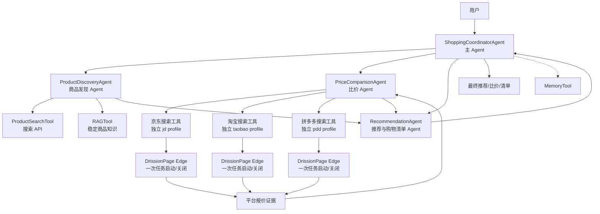

# 智能购物助手：统一项目设计文档

## 1. 项目定位

本项目是 HelloAgents 第 16 课毕业项目方向下的智能购物助手。官方毕业项目要求构建一个可运行、可说明、可提交的完整多智能体应用；智能购物助手属于生活服务类方向，适合用来展示 Agent 范式、工具调用、记忆、RAG、上下文工程和多 Agent 协作。

本项目解决三个核心目标：

1. 用户知道型号时，比较同一商品在不同平台的实际条件。
2. 用户只知道预算和用途时，发现并推荐合适商品。
3. 用户需要买多件东西时，生成推荐清单并计算总预算。

## 2. 最终用户流程

```text
用户请求
  ↓
主 Agent 理解意图、预算、型号、用途、数量和约束
  ├─ 已知型号 → 比价 Agent
  ├─ 只有预算/用途 → 商品发现 Agent → 比价 Agent
  └─ 多件商品 → 对每个类别发现/比价 → 推荐 Agent 生成清单
  ↓
推荐 Agent 综合候选、平台报价和购买条件
  ↓
主 Agent 检查完整性并面向用户输出
```

## 3. 多智能体架构



### 3.1 主 Agent：ShoppingCoordinatorAgent

主 Agent 是用户唯一直接面对的 Agent，负责：

- 识别三类目标：指定型号比价、模糊需求推荐、多商品清单；
- 提取预算、用途、型号、规格、数量和平台范围；
- 决定调用哪些专业 Agent 和调用顺序；
- 把商品发现结果交给比价 Agent；
- 把候选和报价交给推荐 Agent；
- 检查证据是否完整，再生成最终回答。

主 Agent 不直接操作平台页面，也不负责从页面正文中逐条找价格。它负责流程编排和结果验收。

### 3.2 商品发现 Agent：ProductDiscoveryAgent

商品发现 Agent 处理用户没有明确型号的请求。它可以调用 `ProductSearchTool` 和 `RAGTool`，根据预算、用途、品类、品牌偏好和数量输出候选商品。

输出应包括候选型号、关键规格、适用理由和来源。搜索 API 只用于发现候选，不作为淘宝、京东或拼多多的实时价格来源。

已知型号时，主 Agent 可以跳过商品发现 Agent，直接进入比价流程。

### 3.3 比价 Agent：PriceComparisonAgent

比价 Agent 接收一个或多个明确商品型号，调用：

- 京东搜索工具；
- 淘宝搜索工具；
- 拼多多搜索工具。

三个平台在一次比价任务中共享一个 `.drission-edge-profile`，分别使用三个标签页。比价 Agent 启动一个 Edge/DrissionPage 浏览器，三个平台工具各自创建一个标签页，读取页面正文，判断登录或验证码状态，三个工具完成后统一关闭浏览器。登录 Cookie 会写回共享 profile，下一次任务继续复用。

这样既避免了三个浏览器重复启动，也避免同一个 profile 被多个 Chromium 进程同时写入。平台工具可以并行处理不同标签页，但浏览器生命周期由共享会话管理器统一控制。

平台工具不依赖脆弱的商品卡片 XPath，也不在 Python 中猜测价格归属。工具返回 `raw_page_text`，比价 Agent 从商品标题附近的正文证据中识别价格、规格、店铺、补贴、激活和购买条件。

统一报价证据形态：

```python
{
    "platform": "jd",
    "title": "商品标题",
    "specification": "256GB",
    "price_text": "¥10697",
    "price_type": "补贴后到手价",
    "seller": "店铺名称",
    "conditions": ["需激活"],
    "detail_url": None,
    "evidence_text": "页面中的原始证据片段",
    "confidence": "explicit",
}
```

没有明确价格、链接或规格时，必须标记为未确认，不能推测。

### 3.4 推荐 Agent：RecommendationAgent

推荐 Agent 综合商品发现结果和比价结果，负责：

- 对齐同型号、容量、版本和购买条件；
- 排除明显不是同一商品的价格；
- 比较价格、店铺、补贴、激活、配送和售后条件；
- 给出单品推荐和推荐理由；
- 对多件商品生成商品、数量、单价、平台、小计和总预算；
- 对总价进行可复核计算。

它不重新打开平台页面，只使用发现 Agent 和比价 Agent 提供的证据。金额计算应使用计算工具或确定性的 Python 逻辑，不能让模型凭字符串心算。

## 4. 三类业务流程

### 4.1 已知型号比价

```text
用户：比较 iPhone 18 Pro Max 在三个平台的价格
  ↓
主 Agent 识别型号和规格
  ↓
PriceComparisonAgent 并行调用京东/淘宝/拼多多工具
  ↓
RecommendationAgent 对齐条件并推荐
  ↓
主 Agent 输出平台价格、条件和购买建议
```

### 4.2 预算和用途推荐

```text
用户：3000 元以内，推荐拍照好的手机
  ↓
主 Agent 提取预算和用途
  ↓
ProductDiscoveryAgent 查询候选商品和稳定知识
  ↓
PriceComparisonAgent 查询候选型号的三个平台价格
  ↓
RecommendationAgent 综合适合度、价格和购买条件
  ↓
主 Agent 输出推荐
```

### 4.3 多商品清单

```text
用户：准备一份 1000 元的宿舍用品清单
  ↓
主 Agent 拆分商品类别和数量
  ↓
商品发现 Agent 逐项寻找候选
  ↓
比价 Agent 查询需要实时价格的商品
  ↓
推荐 Agent 生成清单、数量、小计和总预算
  ↓
主 Agent 检查是否超预算并输出方案
```

## 5. HelloAgents 能力映射

| 项目模块 | HelloAgents 能力 | 作用 |
| --- | --- | --- |
| 主 Agent | `ReActAgent` | 意图理解、任务路由和最终汇总 |
| 商品发现 Agent | `ReActAgent` + `ToolRegistry` | 调用搜索和 RAG |
| 比价 Agent | `ReActAgent` + 三个平台工具 | 并行获取平台页面证据 |
| 推荐 Agent | `ReActAgent` + CalculatorTool | 比较、推荐、清单和预算 |
| 用户偏好 | `MemoryTool` | 保存用户明确表达的长期偏好 |
| 稳定商品知识 | `RAGTool` | 参数、选购原则和版本知识 |
| 页面上下文 | Context Engineering | 组织大段正文和证据片段 |
| Agent 间调用 | 本地结构化委托工具 | 当前单进程实现；未来可换 A2A/MCP |
| 运行观测 | Trace | 记录每个 Agent 和工具的决策、输入和输出 |

当前先采用同进程的上下文隔离子 Agent，避免为本地毕业项目引入不必要的网络服务。未来需要跨进程部署时，再将专业 Agent 暴露为 MCP 或 A2A 服务。

## 6. 浏览器和登录设计

登录脚本启动一个 Edge，在三个标签页打开平台页面，三个页面共享 `.drission-edge-profile`。

实际比价时：

1. 比价 Agent 并行调用三个平台工具；
2. 第一个工具启动共享 Edge，其他工具复用同一浏览器并创建新标签页；
3. 每个工具访问自己的搜索页并读取可见正文；
4. 遇到登录失效或验证码，返回明确错误码；
5. 三个工具都完成后，共享会话管理器关闭浏览器；
6. profile 保留，供下次继续使用。

页面正文是渲染后的 `body` 可见文本，不是 HTML、脚本、Cookie 或浏览器地址栏。正文解析和价格归属由比价 Agent 完成。

## 7. 可靠性和证据规则

- 搜索 API 负责候选发现，不负责实时平台报价。
- 平台报价必须来自当前页面正文。
- 价格必须和附近的商品标题、规格、店铺和条件关联。
- 隐藏价格、模糊价格和没有明确归属的数字不能作为确定报价。
- 平台登录失效、验证码或页面异常必须保留为平台状态，不得当成商品文本。
- 一个或多个平台失败时，推荐 Agent 可以基于可用平台继续，但要说明数据不完整。
- 主 Agent 不得把子 Agent 的计划当成已经完成的结果。

## 8. 当前实现状态与演进

当前已验证的底层能力是 DrissionPage 读取三平台正文；项目代码已经按本设计改为主 Agent、商品发现 Agent、比价 Agent 和推荐 Agent，并切换到共享 profile、同一浏览器多标签页和每次任务启动/关闭浏览器。下一步需要重新完成多 Agent 端到端验证。

完成后，项目将具备 HelloAgents 毕业项目需要展示的完整链路：多 Agent 任务拆分、工具调用、实时页面证据、RAG、记忆、上下文管理、预算计算、trace 和可运行演示。

## 9. 项目运行和交付

```powershell
.\.venv\Scripts\Activate.ps1
pip install -r requirements.txt
.\.venv\Scripts\python.exe .\scripts\login_platforms_drission.py
python -m shopping_assistant
```

交付材料包括 Python 源码、`requirements.txt`、`.env.example`、本设计文档、可复现的演示命令和脱敏 trace。API 密钥、Cookie、密码和浏览器 profile 不提交到 Git。
