<h1 align="center">AutoHarness</h1>
<p align="center"><strong>Claude Code 的自学习 Skills</strong></p>

<p align="center">
      <a href="https://repositoryradar.dev/repo/tigerless-labs/autoharness"></a>
</p>

**autoharness 是 Claude Code 的自学习 skill 层。** 它从真实会话中**学习** skill，把相同场景的 skill **合并**起来，而不是不断堆叠近似副本，在使用过程中**更新**它们，并清理停止使用的 skill——让这一层**自行保持整洁**，并且**只触碰它自己写入的 skill**。

同一个模型，不同的 harness——CORE-Bench ([HAL](https://arxiv.org/abs/2510.11977)) 从 42% 提升到 78%。Harness 承担了大量工作（swyx 的 **Big Model vs Big Harness**），但每一代模型仍然需要手工重建。autoharness 选择其中一个切面下注：skill 层可以自己维护自己。

| | |
|---|---|
| **从真实工作中学习** | 每个 episode 都从你正在进行的会话中提炼成一个 skill——不需要单独的数据收集或回放循环。一次会话完成足够工作后，它会自动触发；想立即保存一条经验时，可以使用 `/learn` 按需提炼。 |
| **分组，而不是只会堆积** | 新 episode 不一定会新增 skill——reflector 会把它与现有内容比较，并把相同场景的 skill 合并到一起，因此这一层按类别收敛，而不是积累近似副本。每次合并都会记录哪个 skill 吸收了哪个 skill，因此不会把合并误认为死亡。 |
| **让自己的库保持可见** | 每个会话开始时都会打开一个按组整理的索引，列出它写入的 skill，因此召回不依赖宿主是否碰巧展示它们。宿主原生的召回机制保持完全不变；这个索引是在其上增加的一层。 |
| **通过使用验证，而不是基准测试** | 一个 skill 能否保留，取决于它在后续回合中是否被遵循（在它可用的请求中被加载的比例），而不是留出数据集上的分数。活跃路径上没有 oracle，也不需要为专门评估消耗 token。 |
| **只管理自己的 skill** | 只触碰这个插件生成的 skill——其他内容，无论是你写的还是安装的，都完全不受影响。 |
| **保留证据供以后使用** | 每次创建或更新都会把场景和决定记录到每个 skill 的 ledger 中——如果将来需要，可以用这些原材料从真实使用情况建立基准测试。 |

## 安装

**要求 PATH 中的 `python3` 为 Python 3.11 或更高版本**——autoharness 完全使用 Python 运行（零第三方依赖）；没有它，Hook 和 MCP server 不会运行。Hook 会解析 PATH 中不带路径的 `python3`，因此如果较旧的解释器排在前面（Xcode 自带 `/usr/bin/python3` 3.9.6），整个会话的 Hook 都会关闭；autoharness 会在 stderr 中说明原因。

在 Claude Code 的输入框中执行：

```
/plugin marketplace add tigerless-labs/autoharness
/plugin install autoharness@autoharness
```

然后运行 `/reload-plugins`（或重启 Claude Code）。

无需配置。现在它会在后台观察你的会话，并把学习到的 skill 放入 `.claude/skills/`。学习节奏和生命周期阈值可以调整——见[配置](#配置)。

通常不需要手动调用，但有一个入口可供你主动使用：**`/learn`** 会提炼你当前所在的会话——在解决问题后输入它，这条经验会经过与后台流程相同的提案和校验链。

**MCP server 命名。** `.claude-plugin/plugin.json` 将 server 注册为 `stage_skill`，但 Agent 定义引用的是完整名称 `mcp__plugin_autoharness_stage_skill__stage_skill`。这种转换是自动完成的：插件运行时根据插件名称（`autoharness`）和 server key 构造完整名称。在插件上下文之外（例如手动注册 server），工具名称会是 `mcp__stage_skill__stage_skill`——但 Agent 的 allowlist 仍然引用带插件命名空间的形式。请始终作为插件安装，以匹配这两个名称。Server 定义在 manifest 中，而不是根目录的 `.mcp.json` 中，因为插件根目录就是仓库根目录：如果那里有 `.mcp.json`，它也会成为这个 checkout 的项目配置，其优先级高于插件中相同命令的 server，导致在仓库内部运行的会话中 reflector 没有这个工具。

### 更新

下面使用终端形式展示更新和卸载命令（`claude plugin …`）；在 Claude Code 内部，相同操作位于 `/plugin` 菜单中。

从终端更新——先按 marketplace 名称刷新目录，再使用完整的 **`plugin@marketplace` ID** 更新插件，最后重启：

```
claude plugin marketplace update autoharness
claude plugin update autoharness@autoharness
```

然后**重启 Claude Code** 使其生效——版本号变化代表新的缓存副本，不是热加载。

之所以先刷新，是因为如果不刷新，`update` 会检查过期的本地目录；即使已经发布了新版本，也可能报告 `already at the latest version`。

第三方 marketplace 默认关闭自动更新。想让以后自动更新，只需启用一次：`/plugin` → **Marketplaces** → **autoharness** → **Enable auto-update**。已安装副本由 `plugin.json` 中的 `version` 缓存；只有该字段递增，发布版本才会到达用户。

### 卸载

```
claude plugin uninstall autoharness@autoharness
claude plugin marketplace remove autoharness
```

卸载只会停止插件运行——它已经写入的 skill 和自己的状态位于插件**之外**，仍然保留在磁盘上。如果也要清除这些内容，请删除状态目录（全局层为 `~/.claude/autoharness/`，项目层为 `<repo>/.claude/autoharness/`）以及 `.claude/skills/` 下由它创建的 skill（每个 skill 都带有 `self-authored` ledger 标记，因此很容易与自己的 skill 区分）。你自己的 skill 永远不会被触碰。

## 配置

每个配置项都是带有内置默认值的 `AUTOHARNESS_*` 环境变量——除非要改变运行节奏，否则无需配置。

**存放位置——它管理哪些层**

| 变量 | 默认值 | 作用 |
|---|---|---|
| `AUTOHARNESS_DISABLE_GLOBAL` | `0` | 设为 `1` 时只部署项目层。全局 create intent 会在进入 staging 和落盘之前被拒绝；全局 request/use/view 计数、归档、孤儿清理、召回、curator 快照和 metrics 都会跳过。已有的全局 skill 保持不变。项目层学习正常继续。 |

**节奏——它何时学习**

| 变量 | 默认值 | 作用 |
|---|---|---|
| `AUTOHARNESS_REFLECT_EVERY_N` | `50` | 反思节奏按**工具调用**计数，而不是按回合计数：主会话每调用一次工具，计数器就前进一次；把计数推过 N 的那个回合结束时，会触发后台反思。只有实际工作会触发，只聊天不会触发。值越低，学习越快，启动的子会话也越多。 |
| `AUTOHARNESS_CONSOLIDATE_EVERY_N` | `250` | curator 使用的相同计量单位，它会定期合并整个 skill 库。这个值明显高于反思节奏，因此 consolidation 比 distillation 更少发生。 |
| `AUTOHARNESS_DIGEST_EXCHANGES` | `20` | episode 窗口**之前**有多少次 exchange 会被压缩进 reflector 的 prior-context digest（只保留文本和工具名称）。fork carrier 不使用它，因为 fork 会重放真实会话。 |
| `AUTOHARNESS_CARRIER` | `bundle` | 携带反思内容的方式。`bundle` 把脱敏窗口和 digest 交给一个新的子 Agent。`fork` 会恢复并 fork 刚刚结束的会话，让 reflector 从父会话的热缓存中读取真实对话。在完成 cache-hit 测量之前保持 `bundle`。 |

**召回——模型能看到什么**

| 变量 | 默认值 | 作用 |
|---|---|---|
| `AUTOHARNESS_INDEX_SUSPENDED` | `0` | 设为 `1` 后完全停止注入索引。其他部分仍继续运行——生命周期流程、use/view 计数和上次运行摘要都保留；因此它既可用于测量索引的实际价值，也适用于不愿为索引消耗上下文的用户。 |
| `AUTOHARNESS_INDEX_DESC_MAX_CHARS` | `60` | 会话开始索引中每行 description 的预算。索引是扫描界面，不是完整触发文本；提高它可以容纳更长的行，但每个会话都会增加上下文消耗。 |
| `AUTOHARNESS_SKILL_DESC_MAX_CHARS` | `1024` | skill 自身 description 的硬上限，与宿主记录的限制一致；超长内容会被拒绝，而不会在加载时静默截断。 |
| `AUTOHARNESS_SKILL_BODY_MAX_LINES` | `25` | 高度上限：非空行超过此数量的 `SKILL.md` 正文会被视为 transcript 而不是规则，并被拒绝。支持细节应该放在 skill 的 `references/` 中。 |

**生命周期——什么能够保留下来**

| 变量 | 默认值 | 作用 |
|---|---|---|
| `AUTOHARNESS_MATURITY_PROJECT` | `100` | 项目层的 probation 门槛：skill 落地后，该层再收到这么多请求，就会进入毕业检查。在此之前它照常被召回，但不能被归档。 |
| `AUTOHARNESS_MATURITY_GLOBAL` | `300` | 全局层的相同门槛——因为全局 skill 会加载到每个项目，所以数值更高。 |
| `AUTOHARNESS_CAPACITY_PROJECT` | `50` | 项目层**成熟** skill 的容量上限。对于已毕业的 skill，容量竞争是唯一的死亡原因：成熟池超过上限之前不会归档；超过后，使用率最低的 skill 先被归档。它不限制会话开始索引：probation 成员同样会被列入索引，而且不计入这个容量，因此索引大小取决于创建速度，而不是两个容量上限。 |
| `AUTOHARNESS_CAPACITY_GLOBAL` | `20` | 全局层的相同上限——因为影响所有项目，所以更小。 |
| `AUTOHARNESS_GRADUATION_SUSPENDED` | `0` | 设为 `1` 后完全暂停毕业检查，因此 skill 不会因为未被使用而归档。适用于你有理由怀疑召回界面有问题的情况：此时依据零使用归档，会惩罚从未被提供给模型的 skill。容量竞争仍然生效。 |
| `AUTOHARNESS_SNAPSHOT_KEEP` | `5` | curator 合并前为每棵 skill 树保留的预运行快照数量。合并是单次原子 rename 无法撤销的操作。 |

**通知——及时知道发生了什么**

默认关闭。会话开始摘要会延迟一个会话报告上次运行，只包含计数，不包含名称；下面的通知会在 drain 完成后立即发送同一份运行记录。Fail-open：通知器只有在运行记录写入且 intent queue 清空后才运行，因此通知器缺失、失败或挂起只会延迟 drain，不会让它失败或重复执行。

| 变量 | 默认值 | 作用 |
|---|---|---|
| `AUTOHARNESS_NOTIFY` | _（未设置）_ | 设为 `desktop` 后，每次运行发送系统通知——macOS 使用 `osascript`，Linux 在安装 `notify-send` 时使用它（否则静默不执行）。通知会列出落地和拒绝的内容，例如 `create foo, patch bar · rejected: baz`。macOS 中通知归属于 Script Editor；如果没有出现，请在系统设置 → 通知中允许它。 |
| `AUTOHARNESS_NOTIFY_CMD` | _（未设置）_ | 一个命令（按 shell argv 拆分，但绝不通过 shell 执行），从 stdin 接收运行记录 JSON——格式与 `runs/<run-id>.json` 相同；单行摘要放在 `AUTOHARNESS_NOTIFY_SUMMARY` 中。这是对接 Slack、webhook 或其他服务的入口。skill 名称会先脱敏，并且命令运行时会设置子会话保护，因此即使命令启动 `claude`，它本身也不会被捕获。可以与 `desktop` 同时使用。 |
| `AUTOHARNESS_NOTIFY_TIMEOUT_S` | `5` | 每个通知渠道允许阻塞 drain 的总秒数，最小为 1。`/learn` 的 drain 在宿主的 Stop Hook 中运行，因此这也是它可能延迟一个回合的最长时间。 |

在 Claude Code 启动时设置这些环境变量——可以设置在 shell 中（`export AUTOHARNESS_REFLECT_EVERY_N=10`），也可以设置在 `.claude/settings.json` 的 `env` 映射中：

```json
{ "env": { "AUTOHARNESS_REFLECT_EVERY_N": "10" } }
```

Hook 会在每个事件上读取环境变量，因此修改会从下一个会话开始生效。默认值是等待实证校准的有意占位值；捕获窗口和 staged 文件的字节上限是固定常量，不是环境变量配置项。

## 工作方式

一条学习流水线运行在宿主旁边。Skill 是普通的原生文件，宿主通过自己的名称和 description 机制召回它们，就像它们是人手写的一样——这条路径保持不变。在此之上，每个会话都会打开一个由 autoharness 写入的 skill 索引，因此自己的库是否被提供给模型，是这个插件的属性，而不是对宿主行为的期待。

<p align="center"></p>

<sub>图表源文件：[`docs/assets/pipeline.mmd`](docs/assets/pipeline.mmd)——编辑后重新生成 `pipeline.svg`。</sub>

| 组件 | 作用 |
|---|---|
| **CAP** · capture | 由 Hook 驱动的简单管道：捕获每个回合（用户输入、Agent 输出、工具 I/O），在出口处脱敏，并指回宿主日志而不是复制日志。它还负责触发器；触发器是确定性的，只统计一种东西——工具调用。跨过阈值的回合结束时进行反思；这里不判断内容。 |
| **REF** · reflect | 读取 episode，与现有 skill 索引比较，然后决定新增 / 合并 / patch / 丢弃 support file / 删除——输出一个 intent（包含正文、delta 或路径，以及原因和证据）。如果新经验与旧 skill 冲突，它必须在同一轮重写过时的 skill，不能让库里同时存在互相争论的规则。它只负责提案，没有写入工具；fork carrier 继承的写入工具会在 Hook 层被拒绝。 |
| **promoter** · validate·store | 唯一写入者。在内存中 lint intent（安全性、结构、ledger、完整性、只允许自创建内容），通过后原子地 rename 到活动 skill 目录。新 skill 的 description 必须尽早包含触发词，以便在索引截断前保留下来——如果线索落在截断位置之后，skill 在本来用于召回它的界面上就只剩半句话。合并时必须写明被删除 skill 被哪个 skill 吸收，而且 umbrella 必须是 autoharness 管理的活动 skill——虚构的名称会使整个 intent 失败，而不会丢掉内容。每次运行都会记录落地和拒绝的内容。 |
| **IDX** · surface | 构建会话开始索引：列出 autoharness 写入的 skill，按类别分组，每行使用截断后的 description，并标记层级。归档和手写 skill 会被排除；空库不会注入任何内容；上次运行的落地/拒绝摘要会一起带入，因此被拒绝的提案不会悄无声息地消失。 |
| **MNG** · lifecycle | 无 daemon：每个会话开始时懒计算一次。按使用率为符号排序——使用次数除以符号创建后收到的请求数，因此这个指标相对于机会计算，合上电脑不会让任何 skill 变老（取代墙上时钟）。三个信号彼此分开：**load**（模型调用了 skill）是唯一计入使用率的信号；**view**（会话读取了 skill 目录）说明它有召回价值，但不代表模型遵循了它；**patch** 表示 skill 正在改进，因此 patch 后的一次 load 可以被视为改进后的再次使用。新符号在收到足够请求前处于 probation：照常召回，但不计入容量，也不可被淘汰。成熟时，毕业检查只会归档从未 load **且**从未 view 的符号——没有使用证据不等于有不使用证据。对于已毕业的符号，容量竞争是唯一的死亡原因——层级的成熟池超过容量后，使用率最低的先被归档。归档而不是删除：归档符号只是被移出召回范围的目录，移回来就能复活。 |
| **curator** · consolidate | 更少发生的全库流程：把整个库作为一个整体读取，并把近似副本合并到 umbrella 下；这是单个 episode 无法完成的判断。它在开始前为两层 skill 树都创建快照，因为合并是单次原子 rename 无法撤销的操作。 |
| **LED** · ledger | 每个符号的追加式 sidecar：记录符号为什么产生或改变，以及证据和反思水位。它不放进 skill 正文，因此不会污染召回内容。 |

## 演示：观察它学习

AutoHarness 的所有操作最终都会落到磁盘上的普通文件中——演示只是按正确顺序打开这些文件。要进行快速运行，先加快循环（见[配置](#配置)：

```json
{ "env": { "AUTOHARNESS_REFLECT_EVERY_N": "3",
           "AUTOHARNESS_MATURITY_PROJECT": "5",
           "AUTOHARNESS_CAPACITY_PROJECT": "2" } }
```

**1 · 流水线运行。** 在任意非琐碎任务上正常工作几轮（调试问题、研究工作流等）。当某个回合把工具调用计数推过 N 时，该回合结束时会触发后台反思——不会阻塞会话。状态目录中可以看到它的记录：

```
ls .claude/autoharness/        # 项目层；全局层为 ~/.claude/autoharness/
  requests                     # 层级请求计数（MNG 的分母）
  session-<id>                 # 计入下一次反思的工具调用数
  offset-<id>                  # 上次捕获窗口结束位置的字节水位
  intents/                     # 等待 Promoter 处理的 skill 提案
  runs/<run-id>.json           # 该次运行提议、落地和拒绝的内容及原因
  last_run.json                # 等待下一个会话开始读取的摘要
  snapshots/                   # curator 合并前生成的 skill 树 tar 包
```

**2 · Skill 诞生。** 反思落地后，`.claude/skills/`（项目层）或 `~/.claude/skills/`（全局层——不依赖具体仓库的技术）下会出现新目录。使用 `ls -la`，因为感兴趣的文件是隐藏文件：

```
.claude/skills/<name>/
  SKILL.md                     # skill 本身——普通原生格式，没有私有格式
  .ledger.jsonl                # LED：它为什么诞生 / 改变（追加式）
  .sidecar.json                # MNG 读取的生命周期计数
  references/evidence-*.md     # 支持每条 ledger 记录的 transcript 片段
  scripts/ templates/ ...      # reflector 附带的可选 support file
```

**3 · LED——纸面记录。** 执行 `cat .ledger.jsonl`，每个生命周期事件占一行 JSON：

```json
{"action": "create", "reason": "User asked about the correct command to update a plugin ...", "evidence": "references/evidence-21cd22cc.md"}
{"action": "patch", "reason": "User discovered /reload-plugins is required in-session ...", "evidence": "references/evidence-1a4ec51d.md"}
```

`action` + `reason` + `evidence`——证据文件是教会它这条规则的真实脱敏会话片段，由 Promoter 生成（内容寻址，因此模型不会命名文件）。这就是上表中“保留证据供以后使用”的含义。

**4 · 更新，而不是重复。** 再次遇到同一场景并提出修正（“这里少了一步”），让下一次反思运行。Skill 层不会增长一个近似副本：现有 skill 的 `SKILL.md` 会发生变化，ledger 会追加一行 `patch`/`update`——上面的两行 ledger 就是真实示例。对项目层 skill 执行 `git diff` 可以看到编辑结果。

**5 · 下一个会话开始时已经知道。** 开启新会话，第一项输入就是这些 skill 的分组索引，加上一行上次运行报告，因此被拒绝的提案会明确显示，而不是消失。宿主自己的召回机制仍然在底层保持不变；索引只是确保库一定出现在模型面前。

**6 · 使用有三种计数。** 执行 `cat .sidecar.json`：模型真正加载 skill 时 `use` 增加，这是生存率唯一统计的字段；会话读取 skill 目录时 `view` 增加，表示召回有价值但不代表遵循；Promoter 落地改进时 `patch` 增加，因此 patch 后的一次 `use` 表示改进后再次使用。把这些信号分开，才能防止一个只是被浏览过的 skill 看起来像是被遵循过。

**7 · 退役是归档，不是删除。** 有两条退出路径，都是把目录移动到 `.claude/skills/.archive/<name>/`——ledger、证据和其他内容全部离开召回范围。毕业检查只会归档在整个 probation 阶段既没有 use **也没有** view 的 skill；毕业后，层级成熟池超过容量时，使用率最低的 skill 会被归档。把目录移回来就能恢复，历史保持不变。使用上面的缩小阈值时，这会在一个会话内发生；使用默认值则要经过数百次请求。被合并进另一个 skill 的 skill 也以同样方式归档，但 ledger 会写明吸收它的 umbrella——因此合并和清理仍然可以区分。

**8 · 你的 skill 永远不会被触碰。** 每个 autoharness 创建的 skill 都带有 ledger 标记；没有该标记的内容——无论是你写的还是安装的——对 Promoter 和 MNG 都不可见。

## 对比

自学习 skill 层可以通过留出的基准数据验证，也可以根据自己的使用情况验证。autoharness 选择后者——成本更低，并且适用于没有现成基准的开放式真实主机。

| | 无限增长 | 离线门控的自编辑<br/>([Self-Harness](https://arxiv.org/abs/2606.09498)) | 计时器 + daemon<br/>([hermes-agent](https://github.com/NousResearch/hermes-agent)) | autoharness |
| --- | --- | --- | --- | --- |
| 限制 skill 层大小 | 否 | 是 | 是 | 是 |
| 验证信号 | 无 | 留出基准分数 | 墙上时钟上的不活动时间 | 使用时是否遵循 |
| 什么启动学习流程 | — | 离线批处理 | 空闲时间和经过的天数 | 会话中的实际工作 |
| 把自己的库放到模型面前 | 否 | 否 | 是 | 是 |
| 需要基准 / oracle | 否 | 是 | 否 | 否 |
| 需要常驻 daemon | 否 | 否 | 是 | 否 |

## 致谢

[NousResearch/hermes-agent](https://github.com/NousResearch/hermes-agent)——研究它的自动 skill 创建和记忆 consolidation 设计，帮助 autoharness 形成了基于遵循情况、无需 daemon 的方案。

[AI Coding Tools (Tigerless Labs Workflow 2026)](https://www.youtube.com/watch?v=TM6tGpug1Hc)——AI Insider 频道制作的第三方演示；并非本项目制作，也未经本项目审核。

由 Tigerless Labs 构建。

## 许可证

[MIT](LICENSE)

---

© Tigerless · [tigerless.ai](https://tigerless.ai) · [tigerless.com](https://www.tigerless.com)
